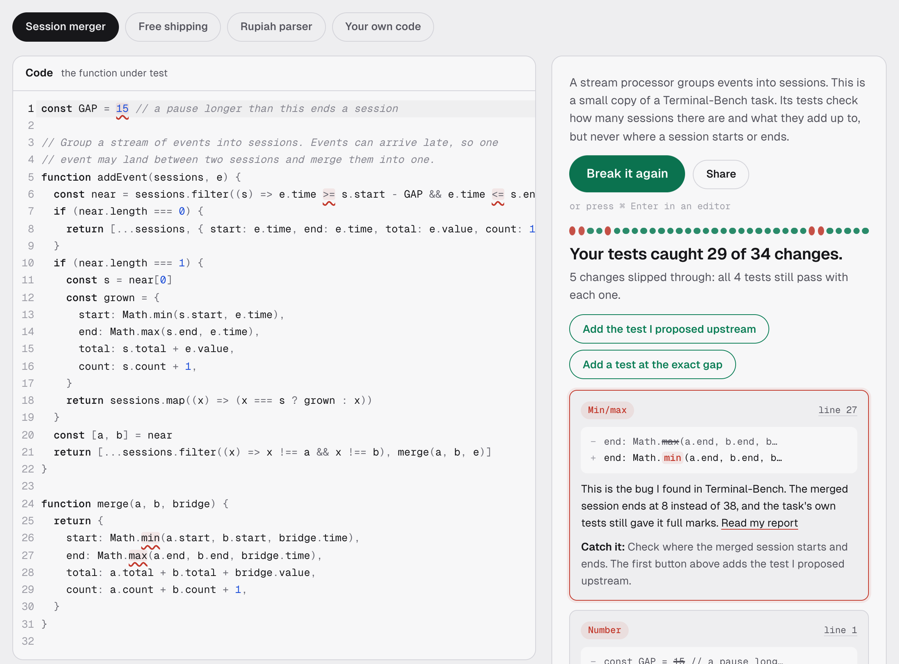

# mutant-lab

**Your tests pass. Would they catch a bug?** Try it: **[fikrialfaraby.com/mutants](https://fikrialfaraby.com/mutants/)**

Mutation testing in the browser. The lab changes your code one small thing at a time (a `<`
into a `<=`, a `max` into a `min`), reruns your tests after every change, and shows each change
that still passes. Every one of those is a bug your tests would let through.



## The first example is a real bug

The session-merger example is a small copy of a task from [Terminal-Bench](https://github.com/harbor-framework/terminal-bench),
a benchmark for AI coding agents. Its tests check how many sessions there are and what they add up
to, but never where a session starts or ends. So when the merge takes `Math.min` of the end times
instead of `Math.max`, the merged session ends at 8 instead of 38, and every test still passes.

I found that gap in the real task with [oracle-mutants](https://github.com/FikriAlfaraby/oracle-mutants),
which does the same thing to benchmark graders, and reported it upstream with a reproduction and a
failing test: [terminal-bench#2243](https://github.com/harbor-framework/terminal-bench/issues/2243).
On the page, one button adds that test and the bug is caught.

## How it works

1. **Find every small change.** [Acorn](https://github.com/acornjs/acorn) parses the code. Each
   comparison, sum, branch, number, min/max, rounding call and `some`/`every` becomes a candidate.
2. **Make one change at a time.** Each candidate gets its own copy of the code with exactly one
   thing changed. Every copy is checked to still parse.
3. **Rerun the tests in a sandbox.** The original code runs first: if its own tests fail, no change
   can be judged, and the page says so. Then each copy runs in its own fresh Web Worker, a few at
   a time, so a timer one copy leaves behind cannot fail another. A copy that runs longer than ten
   times the original (400 ms at least) has its worker terminated and counts as caught, so an
   endless loop cannot freeze the page. The sandbox has no network: `fetch`, XHR, sockets,
   `importScripts` and nested workers are removed before any code runs.

A change is **caught** when a test fails, the code crashes, or it never finishes. It is **missed**
when every test still passes. Not every miss is a bug: some changes cannot alter what the code
does. [Five kinds of survivor that are not bugs](https://fikrialfaraby.com/notes/false-alarms/)
covers how to tell them apart.

| Change | Example | What catches it |
|---|---|---|
| Boundary | `<` → `<=` | a test exactly on the boundary |
| Comparison | `===` → `!==` | a case where the comparison comes out the other way |
| Maths | `+` → `-`, `*` → `/` | an assertion on the exact result |
| And/or | `&&` → `\|\|` | a case where only one side is true |
| Branch | `if (x)` → `if (true)` | a test that takes the other branch |
| Number | `15` → `16`, `0.1` → `0.2` | a test that depends on that exact number |
| True/false | `true` → `false` | a case where the flag matters |
| Min/max | `Math.max` → `Math.min` | values that differ, checking which one is kept |
| Rounding | `Math.round` → `Math.floor` | a fraction that rounds the other way |
| Some/every | `.some` → `.every` | a list where some items match and others don't |
| Not | `!x` → `x` | the opposite case |

Nothing leaves the browser: no server, no account, no model. Share links carry the code in the URL
fragment, and shared code only runs when the visitor presses the button.

## Tests

- `test/examples.test.ts` pins every example's result: which changes slip through, and which
  added test catches which of them. If the engine or an example changes, the page's story cannot
  quietly drift away from what the code does.
- `test/mutate.test.ts` checks each operator's position and replacement, and that every mutant of
  every example still parses.
- `scripts/e2e.mjs` drives the real page in Chromium: runs each example, presses the fix buttons,
  feeds it an endless loop, and fails on any console error. `--video demo.mp4` records the run.

```bash
npm install
npm run check   # typecheck, lint at zero warnings, unit tests
npm run e2e     # build, then the browser run on the demo page
npm run demo    # build and serve the demo at http://127.0.0.1:4180/mutants/
```

## Embedding

`npm run build -- --out <dir>` writes three files: `mutant-lab.js`, `mutant-lab-worker.js` and
`mutant-lab.css`. The host page needs one element:

```html
<div id="mutant-lab" data-worker="/path/to/mutant-lab-worker.js"></div>
```

The lab reads the host's CSS tokens (`--text`, `--accent`, `--line`, ...) and its `.btn` classes,
and falls back to its own. `demo/index.html` is the smallest host.

## How this was made

I build with an AI coding agent (Claude Code) doing much of the typing. I direct it, review the
results, and answer for them. Editor: [CodeMirror](https://codemirror.net/). Parser:
[Acorn](https://github.com/acornjs/acorn). Both MIT.

MIT licence. Fikri Alfaraby, [fikrialfaraby.com](https://fikrialfaraby.com)
